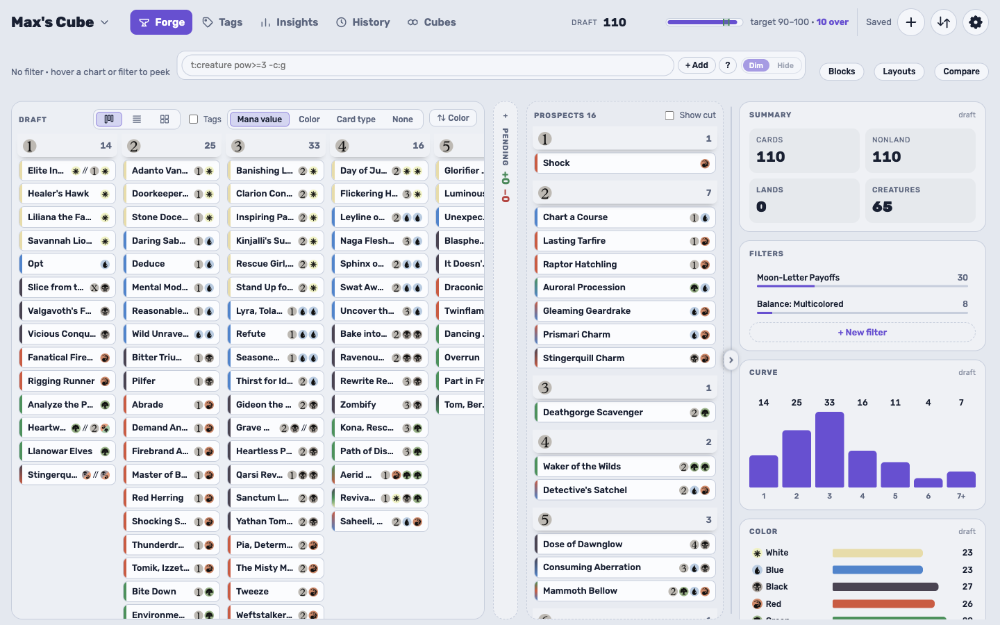

# Cube Goblin

A desktop workbench for designing a Magic: The Gathering [cube](docs/GLOSSARY.md): tune its cards, chart its balance, tag its themes, and share it with the people you draft with. What it's for and why: [VISION.md](docs/VISION.md).



## Install

Cube Goblin runs on Apple Silicon Macs (M1 and later).

1. Download [Cube-Goblin-arm64.dmg](https://github.com/maxhimmel/cube-goblin/releases/latest/download/Cube-Goblin-arm64.dmg).
2. Open it and drag **Cube Goblin** into **Applications**.
3. Open Cube Goblin. macOS says it can't check the app for malicious software, because the app isn't notarized by Apple. Click **Done**.
4. Open **System Settings → Privacy & Security**, scroll down, and click **Open Anyway** next to the Cube Goblin message. Enter your password and click **Open Anyway** again. The button shows for about an hour after step 3.

After that, Cube Goblin opens normally. Apple's guide: [open a Mac app from an unknown developer](https://support.apple.com/guide/mac-help/open-a-mac-app-from-an-unknown-developer-mh40616/mac).

### Updates

When a new version is out, Cube Goblin says so and links to its [release page](https://github.com/maxhimmel/cube-goblin/releases/latest). Download the new dmg, drag it into Applications to replace the old app, and repeat steps 3 and 4. Your cubes stay where they are.

## Develop

Needs Node 22.13+ and pnpm (version in [`package.json`](package.json)).

```sh
pnpm install
pnpm dev        # web workbench at localhost:5173
pnpm desktop    # desktop app
pnpm check      # every guard; must pass before a merge
```

- [CLAUDE.md](CLAUDE.md): commands and working rules.
- [docs/ROADMAP.md](docs/ROADMAP.md): where things stand and what's next.
- [docs/](docs/): vision, views, glossary, tickets, and research notes.
- Releases: `pnpm release <patch|minor|major>` tags a version; [the release workflow](.github/workflows/release.yml) builds and publishes it.

## Credits

Card data and images from [Scryfall](https://scryfall.com). MIT [license](LICENSE).

Cube Goblin is unofficial Fan Content permitted under the Fan Content Policy. Not approved/endorsed by Wizards. Portions of the materials used are property of Wizards of the Coast. ©Wizards of the Coast LLC.
